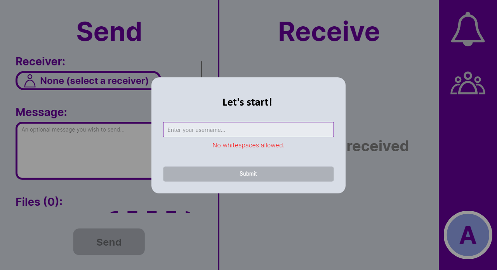

# QuickSend



**QuickSend** is a cross-platform desktop app for sending files and text between computers on your local network. Pick a contact, attach one or more files, add an optional message, and send—received items show up in a dedicated inbox on the other machine.

Built with [.NET](https://dotnet.microsoft.com/) and [Avalonia UI](https://avaloniaui.net/).

## Features

- **Send panel** — Choose an online receiver, write an optional message, and attach multiple files before sending.
- **Receive panel** — View incoming packages with sender info, timestamps, and file metadata; open messages or download attachments.
- **Contacts** — Add peers by ID, search your list, and see who is online or offline.
- **Notifications** — Bell icon in the sidebar for recent activity and unread counts.
- **Profile** — Account avatar and settings from the sidebar.
- **First-run setup** — Choose a username (no spaces) on the welcome screen before you start sharing.

## Platforms

Windows, macOS, and Linux (x64). The project targets **.NET 7** and is packaged as a desktop executable via Avalonia.

## Getting started

### Prerequisites

- [.NET 7 SDK](https://dotnet.microsoft.com/download/dotnet/7.0) (or a newer SDK with roll-forward support)
- An **IP lookup API key** used to resolve your public IP for contact discovery (see below)

### API key (`IPKey.txt`)

On startup the app needs a key for the whatismyip.com API. Either:

1. Place a file named `IPKey.txt` next to the built executable (digits in the file may be obfuscated—the app deciphers numeric characters automatically), or  
2. Pass the key as the first command-line argument when launching.

Without a valid key, the app will not start.

### Build and run

```bash
git clone <repository-url>
cd QuickSend
dotnet build
dotnet run --project QuickSend.csproj
```

For a release build:

```bash
dotnet build -c Release
```

The executable is produced under `bin/Release/net7.0/` (or `bin/Debug/net7.0/` for debug builds).

### Using QuickSend

1. Launch the app and set your **username** on the welcome screen.
2. Add contacts from the **contacts** button in the right sidebar (peer IDs are exchanged out of band).
3. When a contact is **online**, select them under **Receiver** on the Send side, add files and/or a message, and click **Send**.
4. Incoming transfers appear under **Receive**; use the message actions to view text, download files, or save a ZIP.

**Note:** Transfers are intended for machines that can reach each other on the network (same LAN or routable peers). File size per attachment is limited to **2 GB**.

## Project layout

| Path | Description |
|------|-------------|
| `src/` | Application code (views, view models, networking, utilities) |
| `Assets/` | Icons and UI images |
| `docs/screenshots/` | README and documentation images |
| `QuickSend.csproj` | Project file (assembly name may still read `QuickSend` until a full rename) |

## Tech stack

- **UI:** Avalonia 0.10, ReactiveUI  
- **Networking:** TCP sockets for file and message transfer between peers  
- **Data:** Local JSON metadata (contacts, user profile) under the app data folder  

## License

See the repository license file if one is provided; otherwise contact the maintainer for terms of use.
